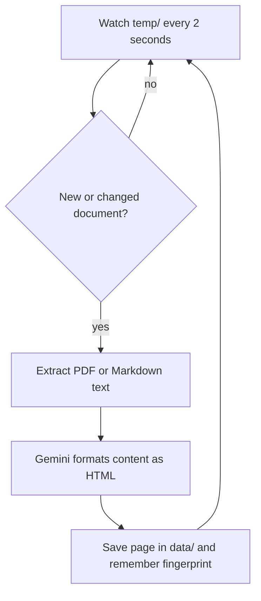

# Event-driven autonomous document agent

Start the agent once. Whenever a PDF or Markdown file arrives in `temp/`, it automatically extracts the text, asks Gemini to format it as HTML, and saves the page in `data/`. No prompt or command is needed for each document.

```text
autonomous-agent/
├── agent.py
├── example.md         # Copy this into temp/ during the demo
├── temp/              # Drop PDF or Markdown files here
└── data/              # Generated HTML pages + processing history
```
Setup and run commands are in the [root README](../README.md#setup). All examples share the root `.venv` and `.env`.

## How the event trigger works



The purpose is configured once: **convert incoming documents into HTML**. File arrival is the trigger, and the watcher runs the work automatically. Gemini chooses the HTML structure; Python handles watching, extraction, and saving. This is a simple event-driven AI agent with a fixed conversion workflow, rather than an agent that chooses arbitrary tools.

## Seminar walkthrough

1. Show empty `temp/` and `data/` folders.
2. Start `agent.py`: it waits for new documents.
3. Copy `example.md` into `temp/` without interacting with the agent terminal.
4. Follow the event → extraction → Gemini → save log messages.
5. Open the generated page and compare it with the original document.
6. Leave the source unchanged: notice that there are no repeated Gemini calls.
7. Edit its content: the agent detects the change and converts it again.
