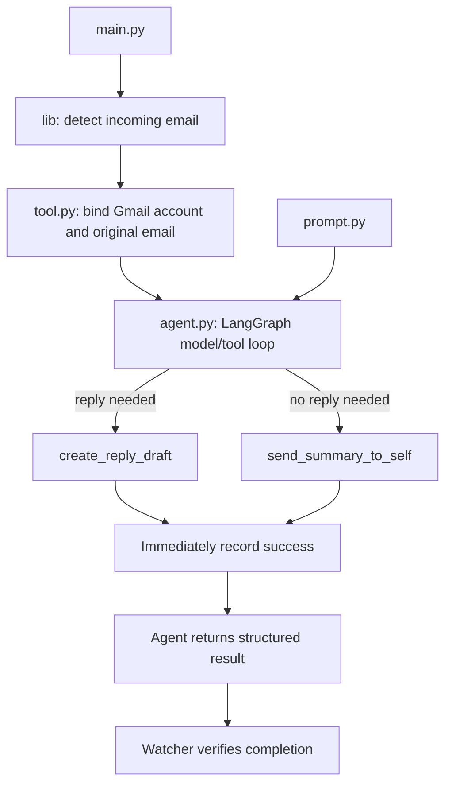

# Gmail live-coding scaffold

All setup and run commands are in the [root README](../README.md#gmail-assistance-live-coding-scaffold).

| File | Role |
| --- | --- |
| `main.py` | Root configuration, model setup and watcher startup |
| `auth.py` | Standalone Gmail authorization |
| `agent.py` | Working builder and invocation, marked for removal before live coding |
| `prompt.py` | Email instructions and action-selection rules |
| `tool.py` | Bind Gmail tools to one email and the authenticated account |
| `lib/gmail_actions.py` | Low-level draft creation and self-summary sending |
| `lib/gmail_auth.py` | OAuth connection and refresh |
| `lib/gmail_client.py` | Gmail reads and MIME handling |
| `lib/models.py` | Input/output schemas and validation |
| `lib/watcher.py` | Polling, agent creation and completion checks |
| `lib/state.py` | Processed-message tracking |

The watcher creates two plain Python tools for each incoming email. Their Gmail connection, original message and recipient addresses are captured in closures. The model sees only text arguments:

- `create_reply_draft(summary, reply)` saves a draft to the original reply address.
- `send_summary_to_self(summary)` sends a summary only to the authenticated account.

Register them in the live-coded `create_agent()` call with `tools=tools`. The agent chooses and executes the action, then returns `EmailAnalysis` through `ToolStrategy`. The watcher verifies that this final answer matches the completed action; it does not call the Gmail action again.

Tool arguments are validated before Gmail writes. A lock permits one action attempt per email during a run, including parallel tool calls. Success is persisted before returning control to the model, so a later generation failure does not cause the successful action to be processed again automatically. A crash between Gmail accepting a write and saving its ID still requires manual reconciliation; see the root README.
