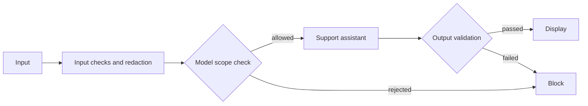

# Guardrails walkthrough

Setup and run commands are in the [root README](../README.md#run-the-guardrails-agent).

| File | What to explain |
| --- | --- |
| `prompts.py` | Scope rules and the fictional course catalogue |
| `guardrails.py` | Input redaction and independent output validation |
| `support_agent.py` | The order of checks and Gemini calls |
| `agent.py` | Root configuration and command-line entry point |

Follow `answer_question()` in order:

1. Reject empty or oversized input and redact common email/phone patterns.
2. Ask a separate Gemini call whether the sanitized question belongs to course support.
3. If allowed, generate a structured answer using the small demo catalogue.
4. Validate the JSON fields, lengths, and contact details before showing the result.

The length, JSON, and regex checks are deterministic. Scope classification is model-based and can be mistaken; it is not a security boundary. The regexes demonstrate basic contact-detail redaction, not comprehensive privacy protection. Output checks do not prove factual accuracy. The catalogue is fictional seminar data, not university policy. Raw input is not logged, and the scope checker receives only the redacted question.
