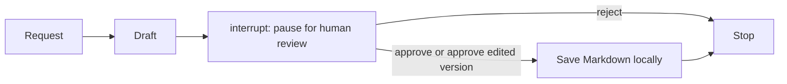

# Human-in-the-loop walkthrough

Setup and run commands are in the [root README](../README.md#run-the-human-in-the-loop-agent).

| File | What to explain |
| --- | --- |
| `prompts.py` | Instructions for the announcement writer |
| `draft_agent.py` | A LangGraph-backed agent that can draft, but has no save tool |
| `workflow.py` | Draft node, interrupt, conditional approval route and checkpoint |
| `actions.py` | The local save action |
| `agent.py` | User interaction and `Command(resume=...)` |

1. The writer creates a draft with no ability to save it.
2. `interrupt()` returns the draft to the caller and pauses the graph before any file is written.
3. A checkpoint stores the current state under a unique `thread_id`.
4. `agent.py` collects approval, an approved replacement, or rejection.
5. `Command(resume=decision)` resumes the same graph and thread. Approval routes to the save node; rejection routes directly to `END`.

`InMemorySaver` keeps the example small: checkpoints exist only while this Python process runs. It demonstrates pause/resume within the running terminal, not recovery after closing it. The review node starts again on resume, so file writes are kept in a separate node after approval. New runs use different output filenames; rejecting a run leaves any older announcements untouched. No emails or messages are sent.
