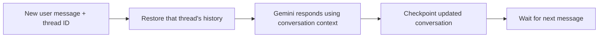

# Conversational memory walkthrough

Setup, run commands, and a sample conversation are in the [root README](../README.md#run-the-memory-agent).

| File | What to explain |
| --- | --- |
| `prompts.py` | Instructions to use known preferences and avoid inventing personal details |
| `memory_agent.py` | `create_agent()` with an `InMemorySaver` checkpointer |
| `agent.py` | Chat loop, thread switching, and inspecting saved messages |

1. Start with `build_memory_agent()`: adding a checkpointer enables conversation memory.
2. Follow `chat()`: only the new user message is sent to `invoke()`.
3. The `thread_id` tells LangGraph which saved conversation to restore.
4. Inspect the message count and saved history to see the checkpoint grow.
5. Switch to a new thread, then back to the original: each has separate history.

This is short-term conversation memory, not model training or memory shared across conversations. `InMemorySaver` stores checkpoints in RAM, so exiting the program loses all threads. Restarting with the same name starts fresh. A database-backed checkpointer would be needed to retain history across restarts. Full history is supplied to the model on each turn; this small demo does not trim long conversations. The model can still make recall mistakes, even when the relevant messages are present.

Reference: [LangChain short-term memory](https://docs.langchain.com/oss/python/langchain/short-term-memory).
