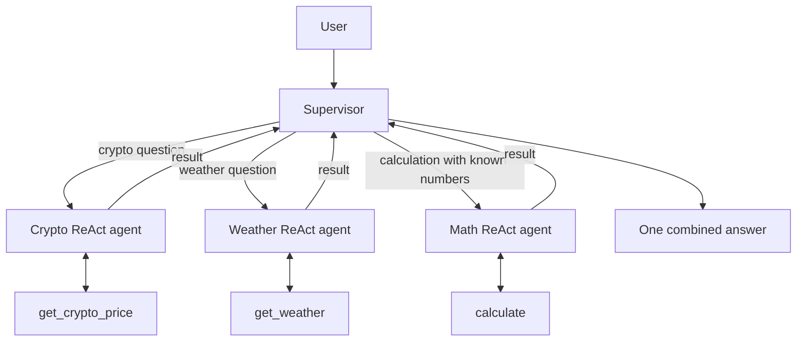

# ReAct agents working as one team

One **Supervisor** delegates the user's task to three specialist **ReAct agents**:

| Agent | Its tool | Example task |
| --- | --- | --- |
| Crypto agent | `get_crypto_price` | Fetch Bitcoin's USD price |
| Weather agent | `get_weather` | Fetch current weather in Islamabad |
| Math agent | `calculate` | Calculate the cost of 0.1 BTC |
| Supervisor | The three specialist agents, exposed as tools | Choose specialists and combine their answers |

Each agent is created with `create_agent`. This is the current supported ReAct-style agent API, built on LangGraph. Every specialist can call its tool, read the result, and answer. The supervisor has its own agent loop and calls specialists as tools. The agents stay separate internally while providing one interface to the user.

## Run

Use Python 3.10 or newer. From the repository root:

```bash
cd multi-agent-collaboration
python3 -m venv .venv
source .venv/bin/activate
pip install -r requirements.txt
cp .env.example .env
# Edit .env and add your Gemini API key.
python agent.py
```

The default question asks for Bitcoin's price and the cost of 0.1 BTC, demonstrating two agents cooperating. Try different tasks:

```bash
# Only the maths specialist is needed.
python agent.py "What is 25 multiplied by 17?"

# Only the weather specialist is needed.
python agent.py "What is the current temperature in Islamabad?"

# Crypto first, then maths using the fetched price.
python agent.py "What is Ethereum's price in USD, and what would 2 ETH cost?"

# Three specialist agents can contribute to one answer.
python agent.py "Give me Islamabad's current temperature, Bitcoin's USD price, and the cost of 0.1 BTC."
```

Model calls use the real Gemini API. Crypto prices come from CoinGecko and weather comes from Open-Meteo. External APIs can fail or rate-limit; the agents should report unavailable data. `.env` in this folder overrides exported variables. Set `GEMINI_MODEL` to change the model.

## How delegation works



For a dependent task, the supervisor obtains one specialist's result and passes the necessary information to another. A typical trace for the default question is:

```text
User -> Supervisor | What is Bitcoin's price and the cost of 0.1 BTC?
Supervisor -> Crypto agent | Fetch Bitcoin's USD price.
TOOL | get_crypto_price | bitcoin
Crypto agent -> Supervisor | bitcoin: <live price> USD
Supervisor -> Math agent | Multiply <live price> by 0.1.
TOOL | calculate | <live price> multiply 0.1
Math agent -> Supervisor | <calculated cost>
Supervisor -> User | Bitcoin costs ...; 0.1 BTC would cost ...
```

These are illustrative placeholders. `collaboration.log` records actual assignments, tool calls, and returned answers. The final response is also written to `answer.md`. Each run replaces these files. The routing is chosen by Gemini rather than keyword checks or a fixed sequence; it may vary across runs.

## Seminar walkthrough

1. Open the shared `../tools/` folder: `crypto.py`, `weather.py`, and `maths.py` contain plain Python functions. `main.py` collects them for imports.
2. In `build_team()`, show three `create_agent()` calls with different prompts and tools.
3. Show `ask_crypto_agent()`, `ask_weather_agent()`, and `ask_math_agent()`: each is a plain function that wraps a complete specialist agent. `create_agent()` converts it into a tool automatically, without `@tool`.
4. Show the final `create_agent()` call: the supervisor's tools are those three wrappers.
5. Run a maths-only question, then the default crypto + maths question. Compare which specialists are called in the logs.
6. Explain the distinction: a normal tool executes a function; an agent tool invokes another model + tools loop before returning its answer.

LangGraph runs the agent loops created by `create_agent`. Recursion limits bound both supervisor and specialist loops. A fresh specialist invocation receives the delegated task, so the supervisor must include any required numbers or context. Weather logs use the prefix `TOOL | get_weather`, and similarly for the other shared tools.

Reference: [LangChain subagent pattern](https://docs.langchain.com/oss/python/langchain/multi-agent/subagents).
