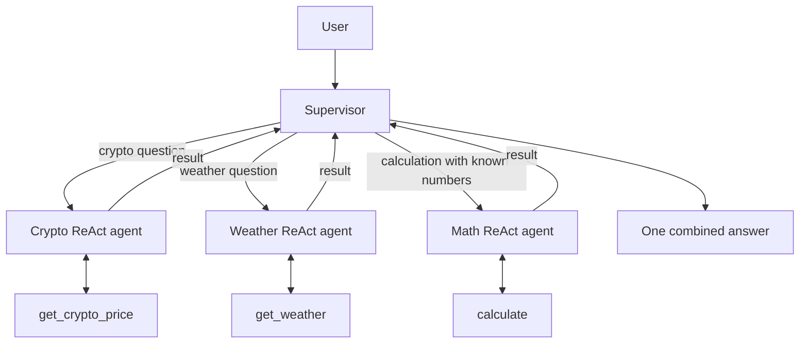

# ReAct agents working as one team

One **Supervisor** delegates the user's task to three specialist **ReAct agents**:

| Agent | Its tool | Example task |
| --- | --- | --- |
| Crypto agent | `get_crypto_price` | Fetch Bitcoin's USD price |
| Weather agent | `get_weather` | Fetch current weather in Islamabad |
| Math agent | `calculate` | Calculate the cost of 0.1 BTC |
| Supervisor | The three specialist agents, exposed as tools | Choose specialists and combine their answers |

Each agent is created with `create_agent`. This is the current supported ReAct-style agent API, built on LangGraph. Every specialist can call its tool, read the result, and answer. The supervisor has its own agent loop and calls specialists as tools. The agents stay separate internally while providing one interface to the user.

Setup and run commands are in the [root README](../README.md#setup). All examples share the root `.venv` and `.env`.

## How delegation works



For a dependent task, the supervisor obtains one specialist's result and passes the necessary information to another. A typical trace for the default question is:

```text
User -> Supervisor | What is Bitcoin's price and the cost of 0.1 BTC?
Supervisor -> Crypto agent | Fetch Bitcoin's USD price.
TOOL | get_crypto_price | bitcoin
Crypto agent -> Supervisor | bitcoin: <live price> USD
Supervisor -> Math agent | Multiply <live price> by 0.1.
TOOL | calculate | <live price> multiply 0.1
Math agent -> Supervisor | <calculated cost>
Supervisor -> User | Bitcoin costs ...; 0.1 BTC would cost ...
```

These are illustrative placeholders. `collaboration.log` records actual assignments, tool calls, and returned answers. The final response is also written to `answer.md`. Each run replaces these files. The routing is chosen by Gemini rather than keyword checks or a fixed sequence; it may vary across runs.

## Seminar walkthrough

```text
multi-agent-collaboration/
├── prompts.py           # Instructions for all four agents
├── crypto_agent.py      # Crypto ReAct agent + price tool
├── weather_agent.py     # Weather ReAct agent + weather tool
├── math_agent.py        # Maths ReAct agent + calculator
├── supervisor_agent.py  # Supervisor ReAct agent
└── agent.py             # Assemble the team, delegate, log and run
```

1. Open `prompts.py` to explain each agent's role.
2. Open a specialist file, such as `crypto_agent.py`: one `create_agent()` call connects its prompt and tool.
3. Open `agent.py`: `build_team()` creates the specialists and wraps them in three plain delegation functions.
4. Open `supervisor_agent.py`: its tools are those delegation functions, so it can choose which specialist to call.
5. Follow `main()` in `agent.py`: it loads the root configuration, creates the model, assembles the team, and handles the user's question.
6. Compare a maths-only question with the default crypto + maths question in the logs. A normal tool executes a function; an agent tool runs another model/tool loop before returning an answer.
